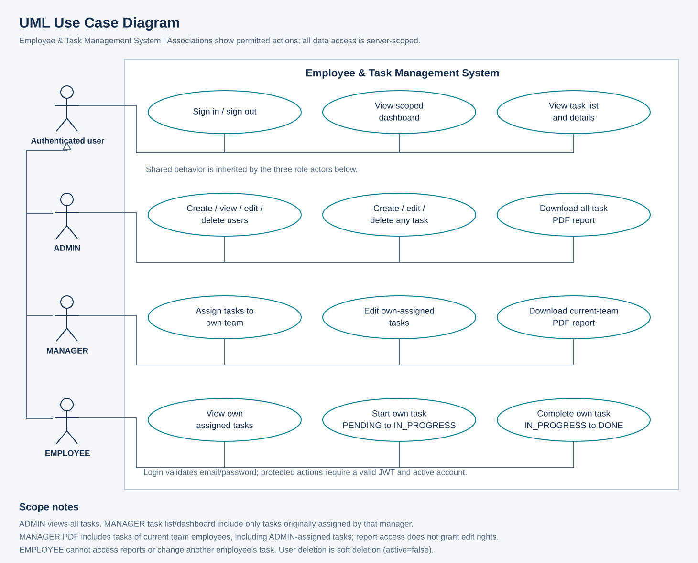
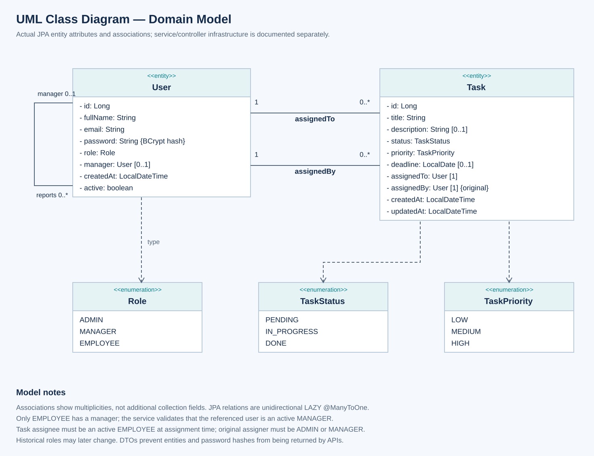
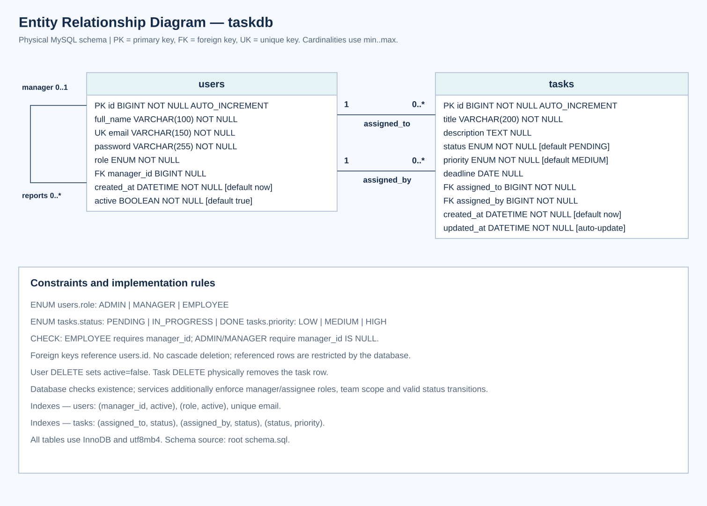

# System diagrams

These diagrams describe the implemented Employee & Task Management System.
SVG files can be opened directly in a browser or edited as vector graphics.
PNG files are portable previews. The accompanying PlantUML/Mermaid files provide
editable semantic sources; their automatic layout may differ from the SVGs.

## UML Use Case

[PNG](use-case-diagram.png) · [PlantUML source](use-case-diagram.puml)

The hollow-triangle actor generalization points toward **Authenticated user**:
ADMIN, MANAGER and EMPLOYEE share sign-in/sign-out, scoped dashboard and task
viewing behavior. Sign-out clears the browser session; it is not a server-side
token revocation endpoint. Role-specific associations show additional actions.
Authentication establishes identity; JWT authentication and current database
role/active checks protect subsequent requests.

Manager task viewing/editing is scoped to the original assigner. The current-team
PDF includes tasks assigned by ADMIN as well. Report visibility never grants task
editing permission. Task details include the description.

## UML Class — domain model

[PNG](class-diagram.png) · [PlantUML source](class-diagram.puml)

This is a domain class diagram, not an inventory of every application class.
It includes the actual JPA entities (`User`, `Task`) and enums (`Role`,
`TaskStatus`, `TaskPriority`). Multiplicity is shown at each association end.
Reverse multiplicities do not imply Java collection fields; all three references
are unidirectional LAZY `@ManyToOne` relationships. No composition/cascade deletion
is implied. Lombok-generated getters/setters are omitted.

The application uses feature packages: controllers accept validated request DTOs,
services enforce ownership/team/status rules, and Spring Data repositories query
the entities. Responses expose DTOs instead of entity/password data.
`TaskReportService` projects report rows and delegates PDF rendering to
`TaskPdfRenderer`; dashboard queries return aggregate counts.

## ER — physical MySQL schema

[PNG](er-diagram.png) · [Mermaid source](er-diagram.mmd)

The authoritative DDL is [schema.sql](../../schema.sql). The ER diagram includes
all columns, nullability, primary/foreign/unique keys and relevant constraints.
For each assignment relationship a task references exactly one user, while a
user can have zero or many tasks. A user can reference zero or one manager; the
role CHECK requires one for EMPLOYEE and none for ADMIN/MANAGER. Service validation
checks the referenced manager's role/active state, which a self-table CHECK cannot
validate. Historical user roles may change after unfinished tasks are resolved.

User deletion is implemented as `active=false`, preserving task relationships.
Task deletion physically removes the task. No cascade deletes are configured.

## Traceability and review

- Use cases: `SecurityConfiguration`, controller `@PreAuthorize` annotations and
  ownership rules in `UserService`, `TaskService` and `TaskReportService`.
- Classes: `backend/src/main/java/io/github/abdulmmh/etm/user/User.java`,
  `task/Task.java` and their role/status/priority enum classes.
- Database: root `schema.sql` (two tables and three foreign keys).
- Diagrams document the existing implementation; they add no feature or schema
  change. Application build/test commands are unnecessary for this docs-only change.
