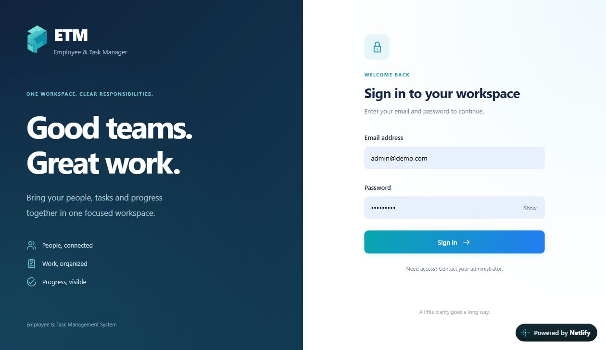
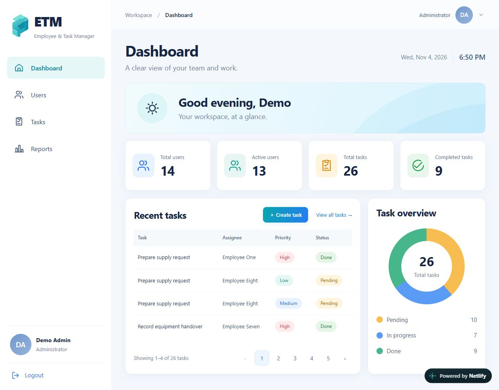
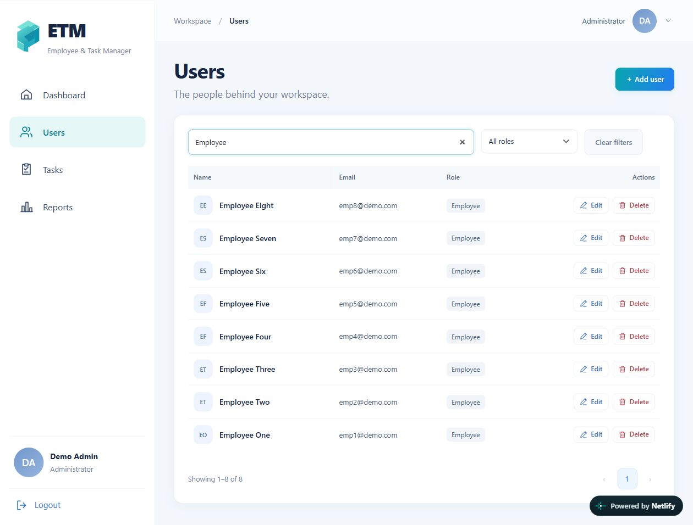
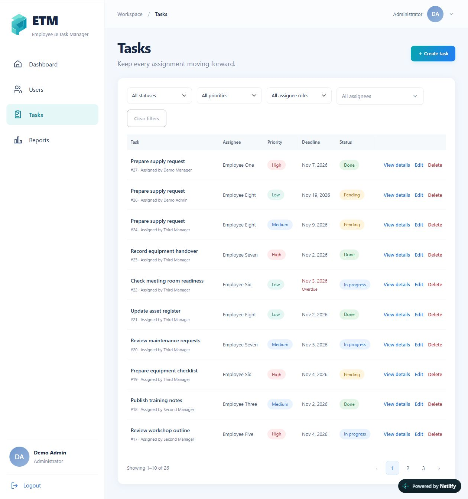
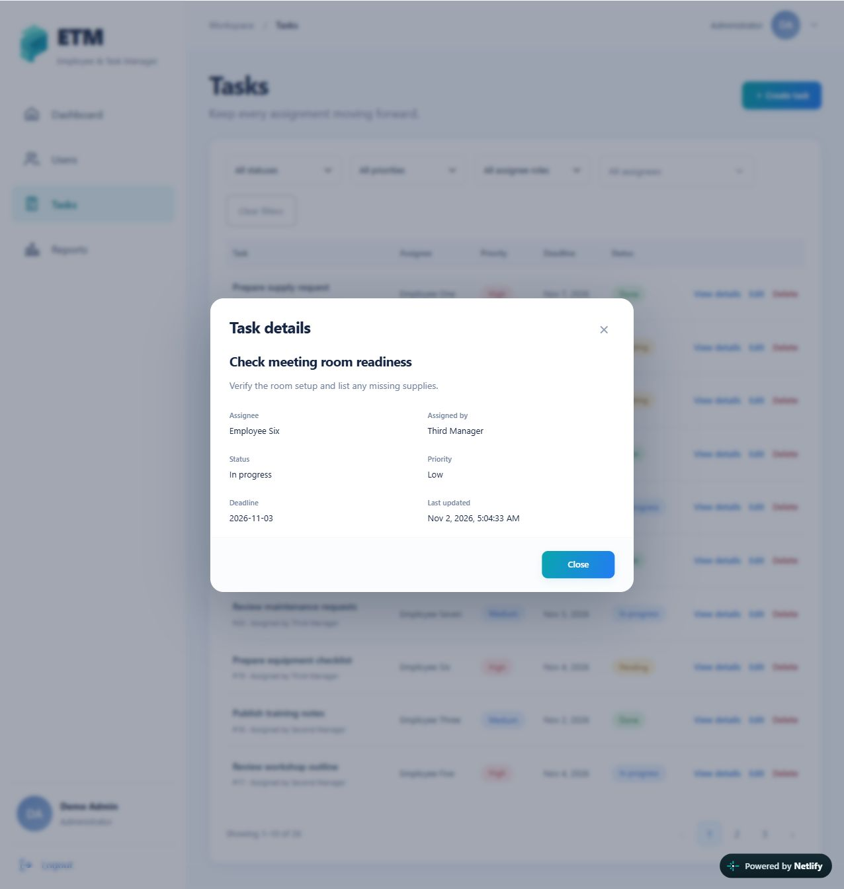
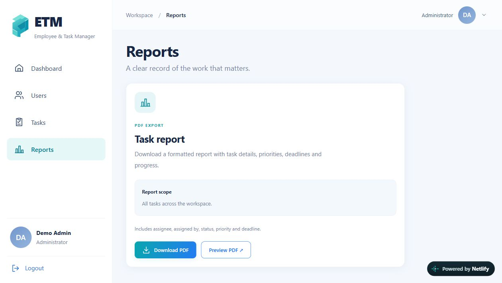
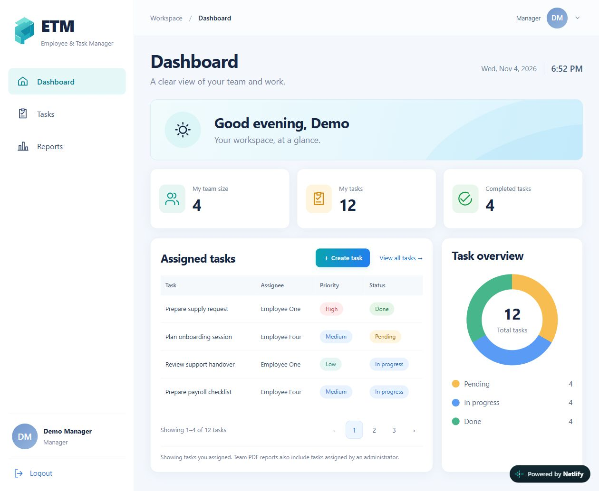
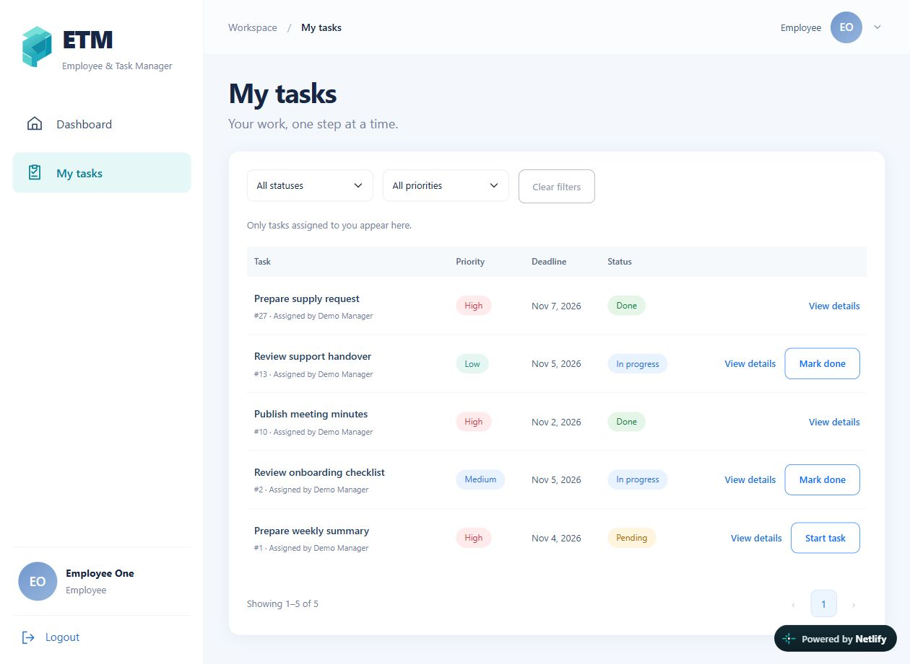

# Application screenshots

Captured from the live application on November 4, 2026. These screenshots show the deployed interface and its current demo data; counts may change as the demo is used. No user or task records were changed to capture these views.

The Users view is filtered by `Employee` to show the seeded demo accounts.

## Sign in

## Administrator dashboard

## User management

## Task management

## Task details

## PDF reports

## Manager dashboard

## Employee tasks

